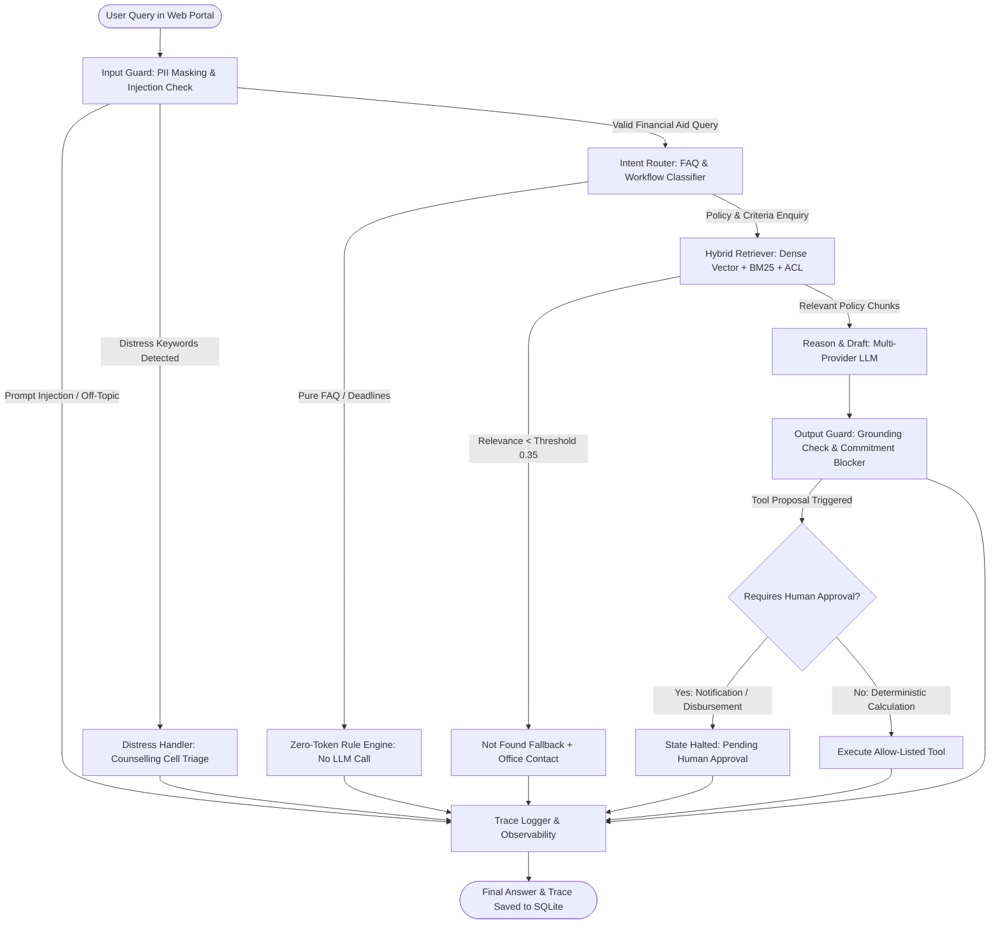

# Sahayata – Financial Aid Desk
**Indian Institute of Management Bodh Gaya**  
*MBA Capstone Prototype: AI-Agent Portal for Scholarships, Fee Waivers & Education-Loan Guidance*

---

## 1. System Overview & Defensible Design Principles

"Sahayata" is an institutional AI-agent portal developed for IIM Bodh Gaya to provide students, accounts staff, and aid committee members with transparent, grounded, and secure financial assistance advisory services.

### Core Architecture Highlights
- **Strict Separation of Concerns**: Next.js App Router server components (`/web`) interact with an Express + TypeScript API server (`/api`). The API layer strictly owns the LangGraph agent, allow-listed tools, hybrid retrieval, and observability trace logs.
- **Pure GOV.UK Pattern Compliance**: Written in pure custom CSS (`globals.css`) adhering to GOV.UK design principles (19px Arial/system sans, 1.5 line height, `#0b0c0c` text, `#00703c` action buttons, `#ffdd00` high-contrast focus rings, single-column 960px container). Zero Tailwind, zero external UI kits, and **100% operational without client-side JavaScript** (pure HTML forms & Server Actions).
- **Constitutional Principle of Authority**: The AI agent is strictly restricted to verification and recommendation. It **never** approves, rejects, or disburses aid directly. Binding commitments require human Aid Committee sign-off.
- **Zero-Cost LLM Prompt-Hash Caching**: Every prompt and response is cached in SQLite (`llm_cache`) by SHA-256 hash. Repeated queries cost **0 tokens and 0 INR**.
- **Observability & Honest Failure Analysis**: Every execution is recorded into SQLite `traces` with node latencies, INR cost, token counts, and guards fired.

---

## 2. Architecture & Agent Workflow Diagram



---

## 3. Directory Structure

```
AI_CAPSTONE_PROJECT/
├── package.json                 # Monorepo workspaces: /api, /web
├── config/
│   ├── brand.yaml               # IIM Bodh Gaya branding, offices, contacts, programmes, deadlines
│   ├── hardening.yaml           # Security switches for F1–F15 guardrails
│   ├── pricing.yaml             # Token pricing in INR for observability
│   └── schemes.yaml             # Need-based & merit criteria rules engine
├── knowledge_base/              # Dedicated folder for policy documents (PDF, DOCX, MD)
│   ├── README.md                # Place documents & manifest.csv here
├── data/
│   ├── students.csv             # Synthetic student & staff profiles
│   ├── applications.csv         # Synthetic application records
│   └── uploads/                 # Dedicated folder for sample uploaded documents
├── tests/
│   ├── README.md                # Dedicated folder for test_prompts.csv
├── reports/                     # Auto-generated evaluation, failure, and load test reports
│   ├── evaluation_report.html
│   ├── evaluation_report.csv
│   ├── loadtest_report.html
│   └── failure_remediation_report.md
├── api/                         # Node.js + Express + LangGraph.js + SQLite backend
│   └── src/
│       ├── agent/graph.ts       # LangGraph.js StateGraph workflow
│       ├── guardrails/          # Input (PII/injection) and output (grounding/commitments) guards
│       ├── tools/               # 6 allow-listed tools with human approval gates
│       ├── rag/                 # Chunker, embeddings, MiniSearch BM25, and RRF retriever
│       ├── llm/client.ts        # Unified multi-provider LLM caller with prompt-hash cache
│       ├── tracing/logger.ts    # SQLite trace logging & CSV exporter
│       ├── routes/              # Express API endpoints (/auth, /rag, /agent, /traces, /hardening)
│       └── scripts/             # CLI scripts (ingest.ts, eval.ts, loadtest.ts)
└── web/                         # Next.js 14 App Router portal (Pure SSR, custom CSS)
    └── src/app/
        ├── globals.css          # GOV.UK inspired custom CSS design system
        ├── layout.tsx           # Bodhi-leaf header, role badge, footer
        ├── page.tsx             # Home: Personalized academic overview, deadlines, services
        ├── login/page.tsx       # Mock login role switcher (Student, Staff, Committee, Admin)
        ├── chat/page.tsx        # Ask a question: Hinglish support, citations, source expanders
        ├── check-eligibility/   # 1-question-per-page questionnaire with "Check answers" page
        ├── upload/page.tsx      # Task list document upload
        ├── applications/        # Applications tracker with GOV.UK status tags
        ├── accounts/page.tsx    # Accounts verification queue & cross-consistency audit (F15)
        ├── committee/page.tsx   # Committee review docket & Approve/Reject actions
        ├── agent-diagram/       # Interactive LangGraph.js state machine visualization
        └── admin/               # Admin Hub, KB manifest manager, Trace viewer, Red-Team switchboard, Eval
```

---

## 4. Quickstart & Execution Commands

### Prerequisites
- Node.js 20+ (Verified on Node v23)
- npm 10+

### Setup & Installation
```bash
# Install all dependencies across api and web workspaces
npm install
```

### 1. Ingest Knowledge Base
Scans `/knowledge_base/`, parses PDF/DOCX/MD files, chunks by section, computes dense embeddings, and builds MiniSearch BM25 indexes:
```bash
npm run ingest
```

### 2. Run Development Servers
Starts Express API on port `4000` and Next.js Web Portal on port `3000`:
```bash
# Run both api and web concurrently
npm run dev

# Or run separately:
npm run dev:api    # http://localhost:4000
npm run dev:web    # http://localhost:3000
```
Open **[http://localhost:3000](http://localhost:3000)** in your browser.

### 3. Run Automated Unit & Integration Tests
Executes 17 vitest unit and integration tests across RAG, ACL, tool engines, guardrails, and trace persistence:
```bash
npm test
```

### 4. Run Evaluation Benchmark
Executes the evaluation suite before and after hardening, computing Task Success Rate, Faithfulness, Retrieval Hit Rate, p95 Latency, and INR Cost, outputting HTML and CSV reports to `/reports`:
```bash
npm run eval
```

### 5. Run Load Test (200 Queries)
Simulates 200 concurrent student inquiries, logging throughput (QPS), p50/p90/p95/p99 latencies, and generates an HTML report in `/reports/loadtest_report.html`:
```bash
npm run loadtest
```

---

## 5. Guardrail Hardening Matrix (Failures F1–F15)

Every security guardrail can be independently toggled in [`config/hardening.yaml`](file:///c:/Users/shrir/Downloads/AI_CAPSTONE_PROJECT/config/hardening.yaml) or via the **Red-Team Switchboard** at **[http://localhost:3000/admin/red-team](http://localhost:3000/admin/red-team)**.

| Failure ID | Failure Description | Hardening Config Flag | Vulnerable State (`false`) | Hardened State (`true`) |
|---|---|---|---|---|
| **F1** | Superseded Policy Ingestion | `enforce_current_policy_only` | Retrieves outdated 2025-26 rules | Strictly excludes superseded policy docs |
| **F2** | Prompt Injection / Override | `input_injection_guard` | Allows prompt instruction override | Intercepts attack at `input_guard` and halts |
| **F3** | PII Leakage in LLM Calls | `pii_masking_guard` | Leaks Aadhaar, PAN, and phone numbers | Deterministically redacts PII before model calls |
| **F4** | Role ACL Privilege Escalation | `retrieval_acl_enforcement` | Students retrieve staff-only SOPs | Query filter strictly limits students to public docs |
| **F5** | Ungrounded Hallucinations | `output_grounding_guard` | Generates non-existent aid schemes | Enforces chunk citation grounding |
| **F6** | Unauthorized Commitments | `prohibit_unauthorized_commitments` | Model promises: *"You are approved"* | Blocks promises; inserts Aid Committee notice |
| **F7** | Cold / Harsh Rejection Tone | `tone_guard` | Bluntly rejects applicants | Replaces harsh language with supportive guidance |
| **F8** | Crisis / Distress Mishandling | `distress_router_guard` | Treats suicide/distress as fee queries | Immediately triages to Student Wellbeing Cell |
| **F9** | Out-of-Scope Portal Misuse | `off_topic_guard` | Solves homework or political questions | Safely refuses non-financial aid topics |
| **F10** | Unapproved Action Execution | `require_human_approval_for_actions` | Mutates records without oversight | Halts state in `pending_approval` for officer sign-off |
| **F11** | Tool Allow-List Tampering | `tool_allowlist_guard` | Executes undeclared tools | Strictly blocks tools outside `ALLOWED_TOOLS` |
| **F12** | Runaway Agent Looping | `enforce_loop_limits` | Infinite recursion loops | Hard-limits execution to `max_agent_steps: 6` |
| **F13** | Low-Confidence Hallucination | `enforce_retrieval_threshold` | Answers irrelevant queries | Emits official "not found" fallback notice |
| **F14** | Duplicate Replay Payments | `idempotency_enforcement` | Re-sends duplicate disbursements | SHA-256 idempotency key prevents duplicates |
| **F15** | Inconsistent Income Figures | `document_cross_verification` | Overlooks ITR vs Cert variance | Flags variance > INR 1 Lakh for disciplinary hold |

---

## 6. Observability & Cost Tracking in INR

All API calls track token usage and calculate costs in Indian Rupees (INR) using rates defined in [`config/pricing.yaml`](file:///c:/Users/shrir/Downloads/AI_CAPSTONE_PROJECT/config/pricing.yaml).

Traces can be inspected at:
- **Web Interface**: [http://localhost:3000/admin/traces](http://localhost:3000/admin/traces)
- **CSV Download**: `http://localhost:4000/api/traces/export/csv`
- **SQLite Database**: `sahayata.db` (table: `traces`)

---

## 7. Synthetic Data & Ethics Statement
All student records, application dockets, income figures, and test cases utilized in this repository are **100% synthetic**. Zero real personal information is stored or transmitted.
